# SlipCast

**Other tools tell you a project is late. SlipCast tells you a ticket will be late while
you're still writing it, and proves how often it's right.**

> This project was formerly called Plotline; it was renamed to SlipCast in v0.5.1.

SlipCast is delivery analytics for software teams. Import ticket history from Jira, GitHub
Issues, Trello or Linear (CSV, no plugin), and it answers two questions:
**"When will this really be done?"** and **"Which tickets are going to slip, and why?"**

**Live demo:** <https://slip-cast.vercel.app>. Click **Try the demo**, sign up, and every
screen below fills with six months of realistic tickets. The API runs on a free instance
that sleeps when idle, so the first load can take up to a minute.

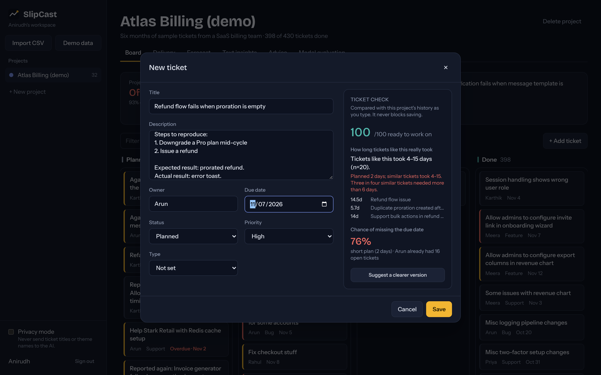

## The problem, and the market

Software teams miss delivery dates constantly, and most can't say why until it's too late.
The usual tools fall into two groups:

| Approach | Examples | What they do well | What they miss |
|---|---|---|---|
| Flow metrics and Monte Carlo forecasting | Jira Advanced Roadmaps, Smart Metrics AI, AgileLens, Axify, Allstacks, the open-source MCS-MCP (which even backtests) | Cycle time, throughput, cumulative flow, probabilistic project dates | Work at the level of the whole project, and after the fact. Ticket *text* is mostly ignored, and accuracy is rarely shown to the user. |
| Gut feel and story points | Planning meetings, spreadsheets | Fast | Systematically optimistic (the planning fallacy) and never checked against what happened |

Flow metrics and Monte Carlo forecasts are **table stakes**. SlipCast builds them compactly as
a foundation and competes on four things:

1. **Reference-class forecasting per ticket.** For any ticket, SlipCast finds the most similar
   *finished* tickets by text and shows how long they really took: *"Tickets like this took
   4–15 days (n=20). You planned 2."* This is Kahneman and Flyvbjerg's reference-class
   forecasting, applied to ticket text.
2. **A write-time risk check.** While someone is typing a new ticket, SlipCast shows its quality
   score, slip risk and reference-class estimate *before work starts*, with a suggested
   rewrite. Competitors analyse after the fact; SlipCast moves risk detection to the moment
   it is cheapest to fix.
3. **A forecast ledger.** Every forecast SlipCast makes is stored and scored automatically when
   the real outcome arrives. Each team sees how accurate the product has actually been for
   them (hit rate and calibration). Honesty is a feature.
4. **Tool-agnostic and private.** CSV import from any tracker, nothing to install, and a privacy
   mode that never sends ticket text to an LLM.

## Feature tour

### Pages
A public **landing page** with the pitch and a one-click demo, a **dashboard** with a card per
project (health, open tickets, 85% forecast date, high-risk count), **Imports** with every past
CSV import and its data-quality report, **Settings** with General (name, privacy mode, theme, AI
provider status), Account (Google/GitHub sign-in, password, sign out everywhere) and **Team**
(members, admin/member/viewer roles, invite links), a plain-language **About** page explaining each method, and a friendly 404. Signed-in
pages share a top navigation bar that collapses to a menu on mobile; every page is lazy-loaded.

| Landing page | Dashboard | Imports |
|---|---|---|
| 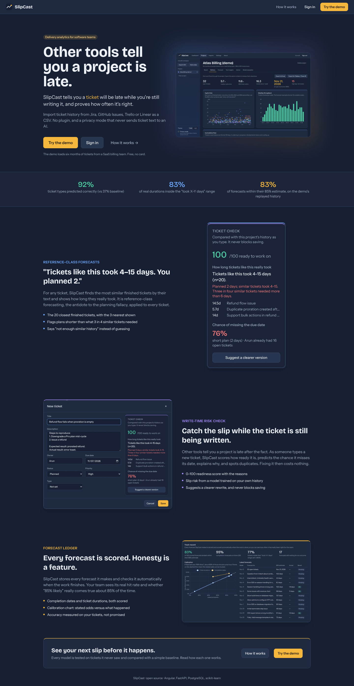 | 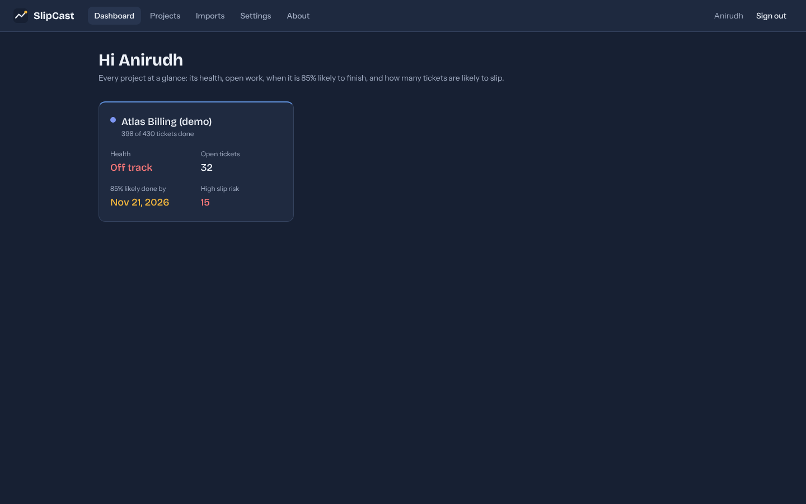 | 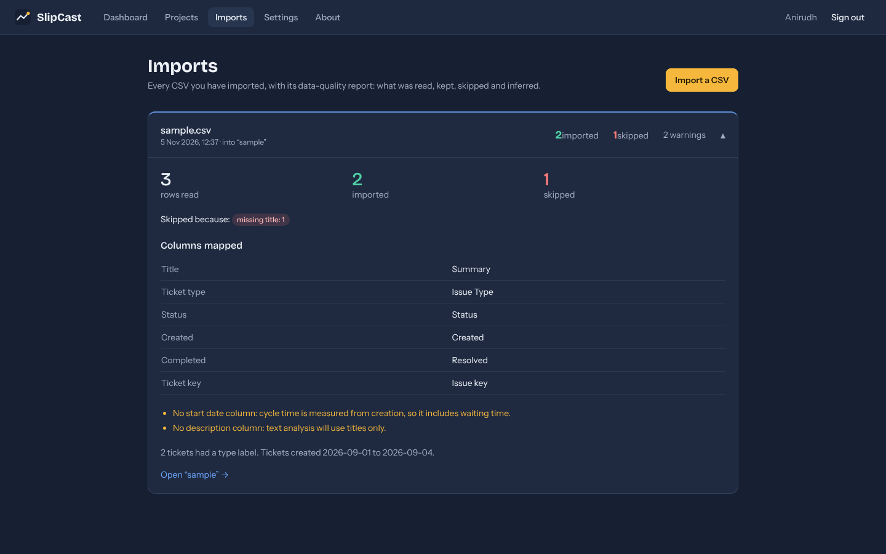 |

### Live updates and alerts
Other systems can send stage changes to a project through the event API with a project key.
Every open screen refreshes within about a second, changed cards glow, and a bell and toasts
say when the 85% finish date moves by two days or more or new work looks likely to slip.
The **Live feed** tab shows how it flows, with copy-paste examples.

### Write-time ticket check
As a ticket is typed, a side panel scores how ready it is (0–100, with reasons), shows how long
similar finished tickets took against the plan, predicts the chance of missing the due date
with the main reasons, flags likely duplicates, and can suggest a clearer version. It responds
in milliseconds, even for a 2,000-ticket project, and never blocks saving. *(Screenshot above.)*

### Delivery: flow metrics and exports
Cycle-time scatter with P50/P85/P95 lines, weekly throughput, a 120-day cumulative flow
diagram rebuilt from status history, breakdowns by type, theme and owner, and aging work
flagged when it passes the P85. One click exports everything to Excel or to tidy CSVs for
Tableau and Power BI.

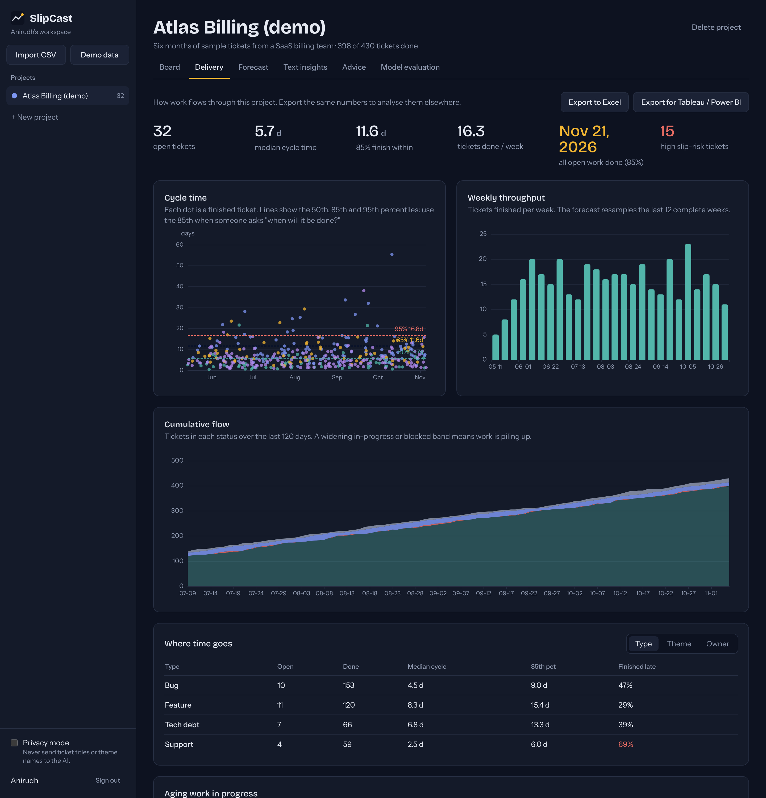

### Forecast, slip risk and track record
A 10,000-run Monte Carlo forecast from the last 12 complete weeks of throughput, with a
target-date checker and burn-up. Below it, the open tickets most likely to slip, and the
**track record**: every past forecast, scored, with a calibration chart.

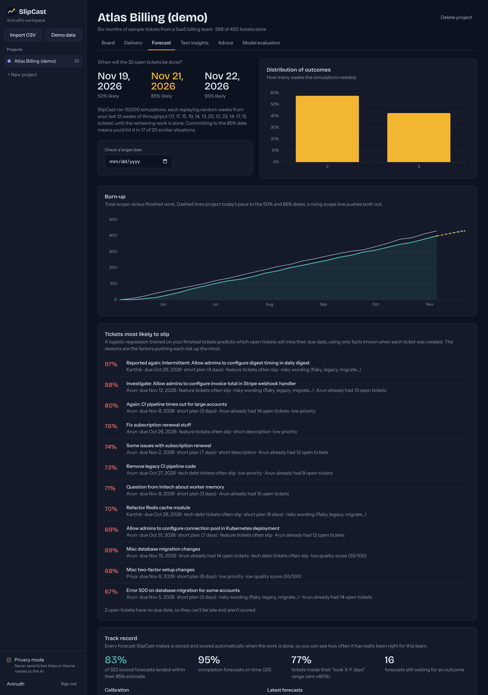

### Text insights
Themes found by clustering ticket text (no manual tagging), ticket types predicted for
unlabelled tickets, the weakest open tickets and likely duplicates.

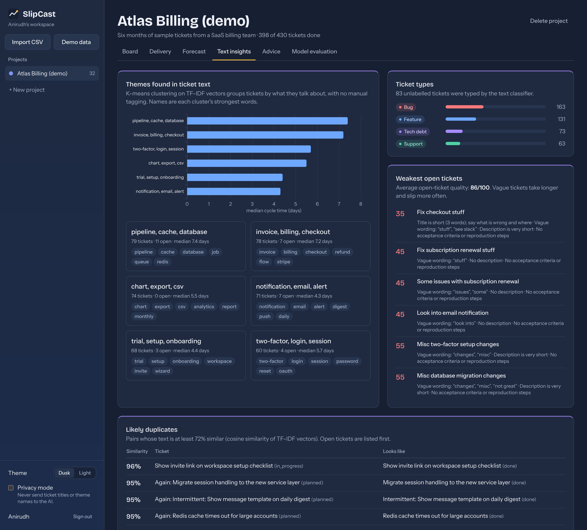

### Advice
An LLM turns *computed findings* into 3–5 actions for the week. Each suggestion cites the
findings it uses, and a validator rejects anything that cites nothing or invents a number.
Without an API key, or when the AI's output fails validation, rule-based advice is shown
instead. Also writes a weekly status report in Markdown.

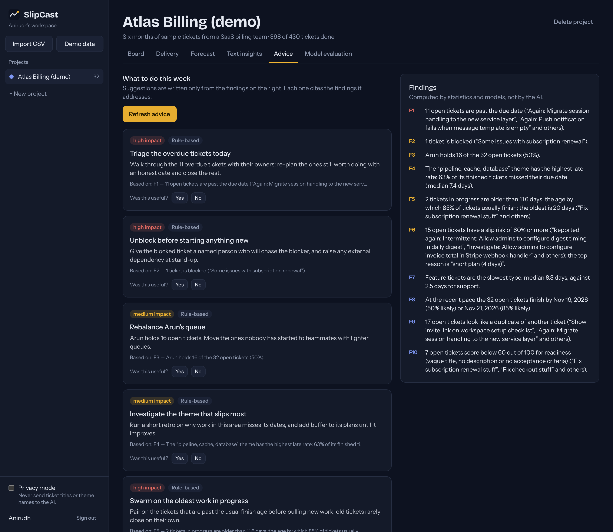

### Model evaluation
Every model, scored on data it never saw against a simple baseline, with confusion matrix, ROC,
precision–recall and calibration charts, the Monte Carlo backtest, reference-class coverage
and the forecast ledger.

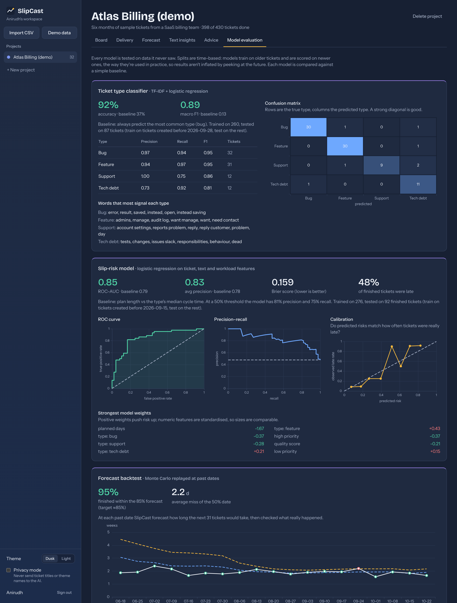

| Board with project health | CSV import with a data-quality report | Sign in |
|---|---|---|
|  |  |  |

### Themes
A soft, colourful **Dusk** dark theme by default and a **Light** theme, switchable in the
sidebar and remembered per browser. Text meets WCAG AA contrast (4.5:1) in both. Cards carry a
thin colour edge by kind (blue for analytics, violet for AI and models, amber for forecasts),
and ticket types have colour chips.

| Before (1.0) | Dusk | Light |
|---|---|---|
| 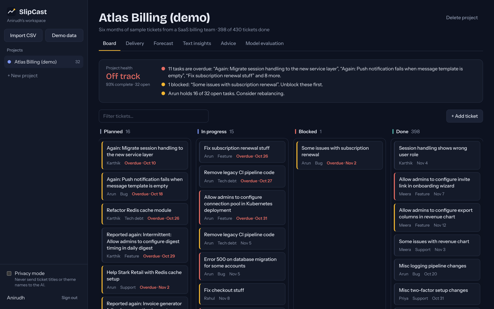 | 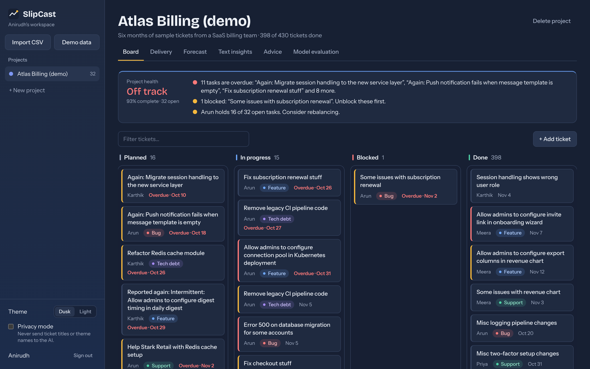 | 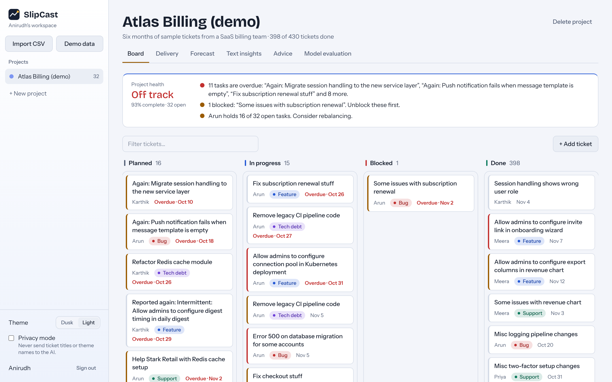 |
| 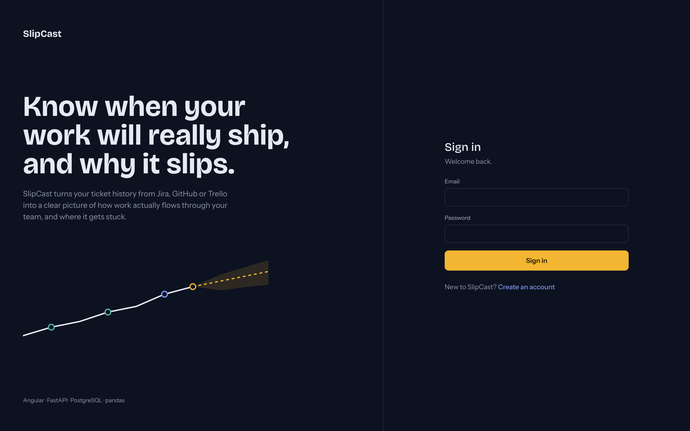 |  | 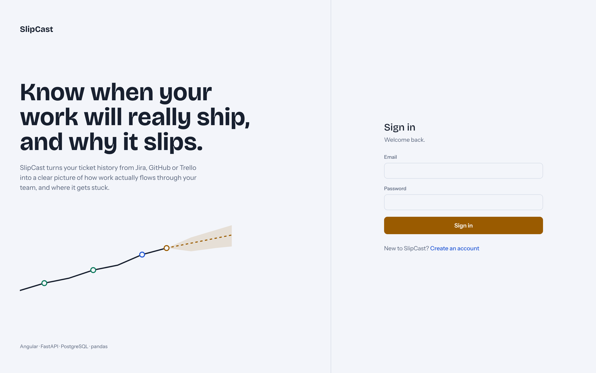 |

## Evaluation results

On the demo project (430 tickets over six months), using **time-based splits**: train on
older tickets, test on newer ones, the way the models are used in practice. Reproduce these
with [notebooks/02_model_evaluation.ipynb](notebooks/02_model_evaluation.ipynb).

| Model | Metric | SlipCast | Baseline | Baseline is |
|---|---|---|---|---|
| Ticket-type classifier (TF-IDF + logistic regression) | Accuracy | **0.92** | 0.37 | always predict the most common type |
| | Macro F1 | **0.89** | 0.13 | same |
| Slip-risk model (logistic regression) | ROC-AUC | **0.85** | 0.79 | the type's median cycle time ÷ planned days |
| | Average precision | **0.83** | 0.78 | same (base rate 0.48) |
| | Brier score | 0.16 | | lower is better |
| Reference-class forecast | P10–P90 coverage | **0.83** | 0.80 | target |
| | P50 error (days) | **2.7** | 3.0 | project-wide median |
| Monte Carlo forecast (backtest) | P85 hit rate | **0.95** | 0.85 | target |
| Forecast ledger (replayed history) | Hit rate within P85 | **0.83** | 0.85 | target |
| Theme clustering (K-means) | Cosine silhouette | 0.21 | | 0.1–0.3 is typical for short text |

The demo data is synthetic, so these numbers show the methods work rather than promise the
same accuracy everywhere. That is exactly why the forecast ledger exists: it measures accuracy
on each team's real tickets.

## Why classical ML plus a constrained LLM

- **Models measure, the LLM advises.** Every prediction (types, themes, slip risk, durations,
  dates) comes from scikit-learn models or statistics that can be evaluated with real metrics,
  compared with a baseline and explained. A per-ticket risk explanation is just coefficient ×
  standardised value, so "short plan (2 days)" is literally why the score is high.
- **The LLM only writes.** It receives numbered findings (F1, F2, …), never raw data, and must
  cite them. A validator rejects any suggestion that cites no valid finding or contains a
  number not present in the findings. Status reports with invented numbers are discarded.
- **It degrades gracefully.** No API key, a bad response or a rate limit (6 a minute, 100 a
  day per user) all fall back to rule-based advice, and the app is fully usable without an LLM.
- **Privacy mode** strips ticket titles and theme names from anything sent to the LLM, and
  ticket rewrites use a template only.
- **Not RAG, not agents.** Single, grounded calls keep cost, latency and failure modes small.

## Exports and notebooks

- **Excel** (`/export.xlsx`): README, Tickets, Status history, Cycle times, Weekly throughput,
  Forecast, Forecast ledger and Model metrics sheets, with real Excel dates.
- **Tableau / Power BI** (`/export/bi.zip`): tidy CSVs, one row per entity, ISO dates. See
  [docs/bi-guide.md](docs/bi-guide.md) for connecting them and three suggested dashboards.
- **Notebooks** ([notebooks/](notebooks/)): exploratory analysis of the demo data, and the model
  evaluation above, saved with outputs so they render on GitHub.

## Architecture

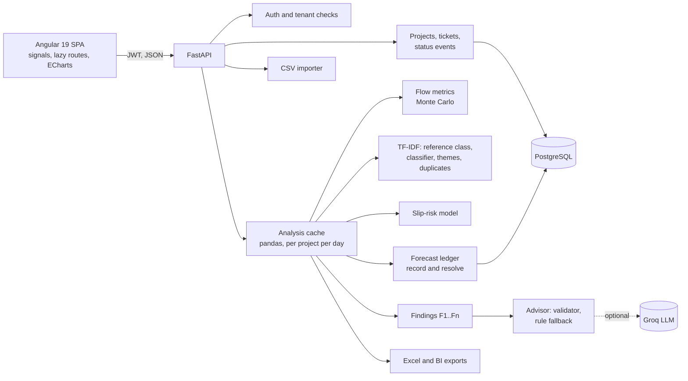

Every analytics request loads a project's tickets and events into pandas once; models are fitted
lazily and cached until a ticket changes or the day rolls over. Details in
[docs/architecture.md](docs/architecture.md).

## Tech stack

| Layer | Tools |
|---|---|
| Web | Angular 19 (standalone components, signals, functional guards and interceptors, lazy routes), Tailwind CSS, ECharts 5 (tree-shaken) |
| API | Python 3.12, FastAPI, SQLAlchemy 2.0, Alembic, Pydantic v2, PyJWT, bcrypt |
| Data and ML | pandas, NumPy, scikit-learn, openpyxl |
| LLM (optional) | Groq (`llama-3.3-70b-versatile`) through a validated, single-call advice layer |
| Database | PostgreSQL (Neon in production), SQLite for local development and tests |
| Quality | pytest (82 tests, including tenant isolation for every endpoint and a fake LLM), Ruff, GitHub Actions with Postgres and `alembic check` |
| Deploy | Docker, Render or Google Cloud Run (API), Vercel or Cloud Run (web) |

## Run it locally

### Option 1: Docker

```bash
docker compose up --build
```

Open http://localhost:4200. API docs are at http://localhost:8000/docs.

### Option 2: Without Docker

```bash
cd backend
python -m venv .venv && source .venv/bin/activate      # Windows: .venv\Scripts\activate
python -m pip install -r requirements-dev.txt
cp ../.env.example .env                                 # add GROQ_API_KEY here if you have one
python -m uvicorn app.main:app --reload
```

In a second terminal:

```bash
cd web && npm install && npm start                      # http://localhost:4200
```

Sign up, then click **Demo data** in the sidebar, or **Import CSV** with your own export.

### Option 3: Without Docker on Windows (Command Prompt)

Use `python -m` for every tool, so the virtual environment is always the one that runs.

```bat
cd backend
python -m venv .venv
.venv\Scripts\activate
python -m pip install -r requirements-dev.txt
python -m alembic upgrade head
python -m uvicorn app.main:app --reload
```

In a second Command Prompt:

```bat
cd web
npm install
npm start
```

The API is at http://localhost:8000 and the web app at http://localhost:4200. If you move
the repository folder, delete `backend\.venv` and create it again: Windows virtual
environments store absolute paths.

## Tests

```bash
cd backend
pytest                                   # 114 tests
ruff check . && ruff format --check .
alembic upgrade head && alembic check    # migrations match the models
```

## API overview

All paths are under `/api`. Every project and ticket endpoint is tenant-scoped.

| Method | Path | Purpose |
|---|---|---|
| POST | `/auth/register`, `/auth/login`; GET, PATCH `/auth/me` | Accounts, personal workspaces, display name |
| GET | `/auth/providers`, `/auth/{google,github}/start`, `/auth/{google,github}/callback` | Sign in with Google or GitHub (state + PKCE) |
| POST | `/auth/password`, `/auth/logout-all` | Set or change password; sign out on every device |
| GET, PATCH, DELETE | `/workspaces/{id}/members[/{user_id}]` | Team members and roles (admin, member, viewer) |
| POST | `/projects/{id}/events` (header `X-SlipCast-Key`) | Stage changes from another system; idempotent, 600 events/min per key |
| GET, POST, DELETE | `/projects/{id}/api-keys[/{id}]`; GET `/projects/{id}/stages` | Per-project API keys (admins) and stages |
| POST | `/projects/{id}/stream-token`; GET `/projects/{id}/stream` | Live updates over Server-Sent Events |
| GET | `/projects/{id}/alerts`, `/workspaces/{id}/alerts` | Forecast moves and risky new work |
| GET, POST, DELETE | `/workspaces/{id}/invites[/{id}]`; GET `/invites/{token}`, POST `/invites/{token}/accept` | Single-use invite links |
| GET | `/auth/ai-status` | Whether advice uses Groq or built-in rules (never the key) |
| GET, POST | `/workspaces/{id}/projects` | List or create projects |
| POST | `/workspaces/{id}/import`, `/workspaces/{id}/demo-project` | CSV import with quality report; demo project |
| GET | `/workspaces/{id}/imports`, `/imports/{id}` | Past imports and their data-quality reports |
| GET, PATCH, DELETE | `/projects/{id}`; GET `/projects/{id}/insights` | Project and rule-based health |
| GET, POST | `/projects/{id}/tasks`; PATCH, DELETE `/tasks/{id}` | Tickets (status changes are recorded) |
| GET | `/projects/{id}/analytics/overview`, `/flow`, `/forecast?target=` | Flow metrics and Monte Carlo forecast |
| GET | `/projects/{id}/analytics/text`, `/risk`, `/evaluation` | Themes, duplicates, quality, slip risk, model evaluation |
| GET | `/tasks/{id}/reference-class`, `/tasks/{id}/analysis` | Per-ticket reference class and full analysis |
| POST | `/projects/{id}/reference-class`, `/projects/{id}/ticket-check` | Reference class and write-time check for a draft |
| GET | `/projects/{id}/forecast-ledger` | Track record of every forecast |
| POST | `/projects/{id}/advice`, `/status-report`, `/rewrite`, `/feedback` | Grounded advice, report, ticket rewrite, votes |
| GET | `/projects/{id}/export.xlsx`, `/projects/{id}/export/bi.zip` | Excel and BI exports |

## Deploy

Step-by-step instructions for Neon + Render + Vercel, or Google Cloud Run, are in
[docs/DEPLOY.md](docs/DEPLOY.md). A two-minute demo script is in
[docs/demo-script.md](docs/demo-script.md).

## Design decisions

- **History as events, not just current status.** Cycle time, flow, forecasting and the ledger
  all need to know *when* work moved, so every transition is stored.
- **Time-based evaluation everywhere.** Random splits leak the future and flatter models.
- **Data quality is visible.** Imports report what was skipped or inferred.
- **404 instead of 403 across tenants**, so the API never confirms another workspace's data exists.
- **Runtime web config.** The Angular build reads `config.js` at load time, so one build deploys anywhere.

## Author

**K Anirudh** · M.Tech AI & Data Science, SASTRA · [GitHub](https://github.com/Vegess) · [LinkedIn](https://www.linkedin.com/in/anirudh-k-908542227/)

MIT licensed.
