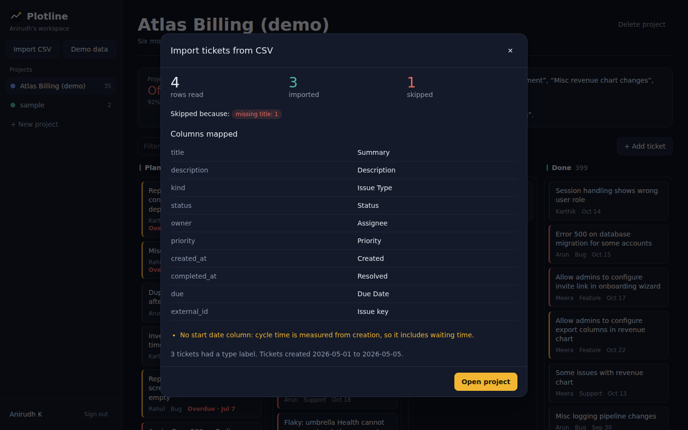
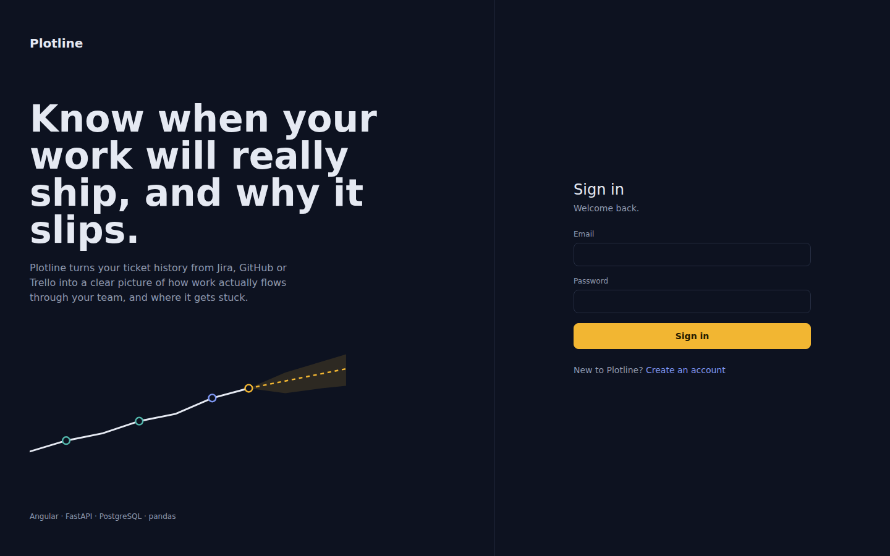
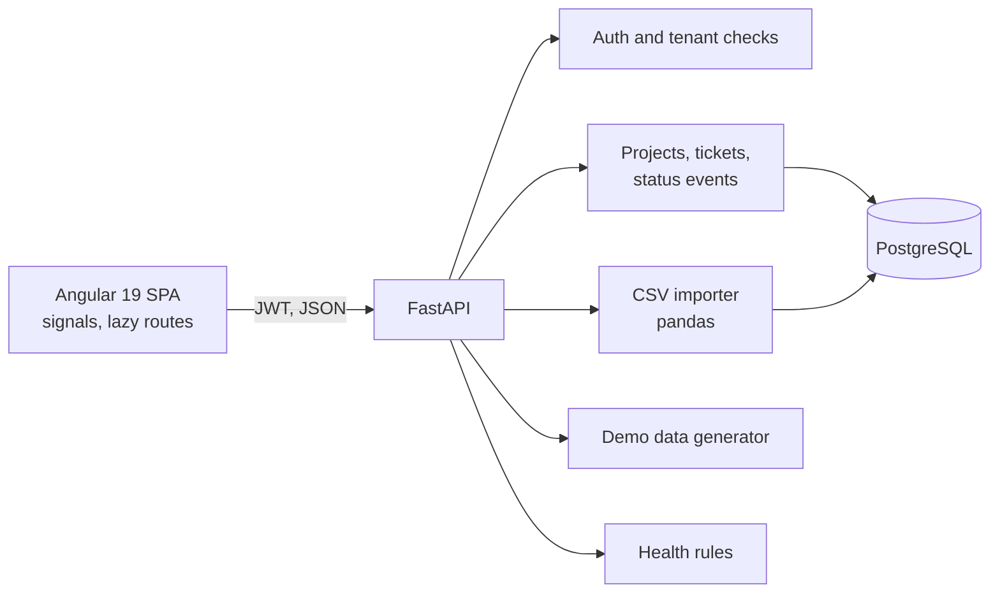

# Plotline

**Delivery analytics for software teams: know when work will really ship, and why it slips.**

Plotline turns a team's ticket history (from Jira, GitHub Issues or Trello) into a clear picture of how work flows: what's moving, what's stuck, and, as the project grows, how long work really takes and when it will finish.


## The problem

Software teams miss delivery dates constantly, and most managers can't explain why until it's too late. Tools in the "engineering intelligence" space mostly analyse numbers such as how long tickets take, throughput and Git activity. The *text* inside tickets (titles, descriptions) is largely ignored, even though it often explains why work is slow: "Flaky payment webhook" and "Update footer link" are both just one ticket in a throughput chart.

Plotline's direction is to analyse **both the numbers and the words** in tickets, using methods that can be measured and explained, and to use an LLM only for turning computed findings into advice.

## Project status

The build is split into two phases.

| Phase | Scope | Status |
|---|---|---|
| **1. Foundation** | Auth and workspaces, projects and ticket board, full status history, CSV import with a data-quality report, demo dataset, rule-based health checks, Angular UI, Docker, CI | ✅ This release |
| **2. Intelligence** | Flow analytics (cycle time, throughput, cumulative flow), Monte Carlo forecasting, NLP (ticket type classifier, theme clustering, duplicate detection, quality score), slip-risk model, model evaluation page, grounded LLM advice | 🔜 Next |

## What works today

- **CSV import with a data-quality report.** Upload a Jira, GitHub Issues or Trello export. Columns are mapped automatically and statuses, types and priorities are normalised. The report shows what was imported, what was skipped and why, and what had to be inferred.
- **Ticket history.** Every status change is stored as an event with a timestamp, and started and completed times are kept consistent. This history is what Phase 2 analytics run on.
- **Demo dataset.** One click generates six months of realistic tickets (about 430) for a SaaS billing team, with the kinds of patterns real teams show.
- **Project health.** Rule-based checks flag overdue, blocked, unowned and overloaded work.
- **Board.** Drag and drop between statuses, quick add, filtering, and full ticket editing.
- **Multi-tenant by design.** Every query joins through workspace membership, and tests assert that another user gets 404 on every endpoint.

| CSV import report | Sign in |
|---|---|
|  |  |

## Architecture



Details: [docs/architecture.md](docs/architecture.md).

## Tech stack

| Layer | Tools |
|---|---|
| Web | Angular 19 (standalone components, signals, functional guards and interceptors, lazy routes), Tailwind CSS |
| API | Python 3.12, FastAPI, SQLAlchemy 2.0, Alembic, Pydantic v2, PyJWT, bcrypt |
| Data | pandas (CSV import and normalisation), NumPy |
| Database | PostgreSQL (Neon in production), SQLite for local development and tests |
| Quality | pytest, Ruff, GitHub Actions with a Postgres service and `alembic check` |
| Deploy | Docker, Render or Google Cloud Run (API), Vercel or Cloud Run (web) |

## Run it locally

### Option 1: Docker

```bash
docker compose up --build
```

Open http://localhost:4200. API docs are at http://localhost:8000/docs.

### Option 2: Without Docker

```bash
# API
cd backend
python -m venv .venv && source .venv/bin/activate      # Windows: .venv\Scripts\activate
pip install -r requirements-dev.txt
cp ../.env.example .env
uvicorn app.main:app --reload

# Web (second terminal)
cd web
npm install
npm start          # http://localhost:4200
```

Sign up, then click **Demo data** in the sidebar, or **Import CSV** with your own export.

## Tests

```bash
cd backend
pytest                                   # auth, CRUD, history, import, demo data, health rules, tenant isolation
ruff check . && ruff format --check .
alembic upgrade head && alembic check    # migrations match the models
```

## API overview

| Method | Path | Purpose |
|---|---|---|
| POST | `/api/auth/register`, `/api/auth/login` | Create an account (with a personal workspace) or sign in |
| GET | `/api/auth/me` | Current user and workspaces |
| GET, POST | `/api/workspaces/{id}/projects` | List or create projects |
| POST | `/api/workspaces/{id}/import` | Import a CSV as a new project and return the data-quality report |
| POST | `/api/workspaces/{id}/demo-project` | Generate the demo project |
| GET, PATCH, DELETE | `/api/projects/{id}` | Read, rename or delete a project |
| GET | `/api/projects/{id}/insights` | Rule-based project health |
| GET, POST | `/api/projects/{id}/tasks` | List or create tickets |
| PATCH, DELETE | `/api/tasks/{id}` | Update a ticket (status changes are recorded) or delete it |

## Deploy

**API (Render):** create a Postgres database on Neon, then create a Render Blueprint from `render.yaml`. Set `DATABASE_URL` and `CORS_ORIGINS` (your web URL). Migrations run on start.

**Web (Vercel):** import the repo with root directory `web`. Edit `web/public/config.js` so `apiUrl` points to your API.

**Google Cloud Run (both):** build `backend/` and `web/` as two services. Pass `API_URL` to the web container; it writes `config.js` at startup, so the same image works in any environment.

## Design decisions

- **History as events, not just current status.** Cycle time, flow and forecasting all need to know *when* work moved, so every transition is stored rather than overwritten.
- **Data quality is visible.** Imports report what was skipped or inferred, because analytics are only as trustworthy as the data under them.
- **404 instead of 403 across tenants**, so the API never confirms that another workspace's data exists.
- **Runtime web config.** The Angular build reads `config.js` at load time instead of baking in the API URL, so one build deploys anywhere.

## Author

**K Anirudh** · M.Tech AI & Data Science, SASTRA · [GitHub](https://github.com/Vegess) · [LinkedIn](https://www.linkedin.com/in/anirudh-k-908542227/)

MIT licensed.
