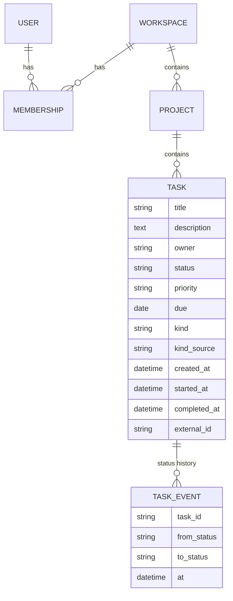

# Architecture

## Layout

```
backend/
  app/
    main.py            app setup, CORS, routers
    config.py          settings from environment variables
    db.py              engine and sessions; normalises hosted Postgres URLs
    models.py          users, workspaces, memberships, projects, tasks, task_events
    schemas.py         Pydantic request/response models
    security.py        bcrypt hashing, JWT
    deps.py            current user and tenant-scoped lookups
    timeutil.py        UTC handling shared by SQLite and Postgres
    routers/           auth, projects (+ health), tasks, data (import, demo),
                       analytics (flow, forecast, models, ledger, exports), advice
    services/
      importer.py      CSV parsing, column mapping, normalisation, quality report
      demo_data.py     deterministic six-month ticket history generator
      insights.py      rule-based health checks
      analysis.py      per-project pandas load and cache; lazy model fitting
      flow.py          cycle time, throughput, cumulative flow, breakdowns, aging
      forecast.py      Monte Carlo forecast, burn-up, backtest
      reference_class.py  TF-IDF nearest finished tickets per ticket or draft
      nlp.py           quality score, type classifier, themes, duplicates
      risk_model.py    slip-risk logistic regression with explanations
      ledger.py        forecast ledger: record, resolve, summarise, demo replay
      findings.py      numbered findings for the advice layer
      advisor.py       Groq client, validator, rule fallback, rewrite, report
      export.py        Excel workbook and BI CSV zip
  alembic/versions/    0001 schema, 0002 ticket history, 0003 forecast ledger, 0004 advice log
notebooks/             exploratory analysis and model evaluation (not shipped in images)
  tests/
web/
  src/app/
    core/              API client, auth service, interceptor, guards, models, workspace store
    shared/            modal, ECharts wrapper, Markdown renderer, formatting helpers
    features/
      auth/            sign-in and registration
      shell/           sidebar, welcome, import and new-project dialogs
      project/         project page and tabs: board, delivery, forecast, text insights,
                       advice, model evaluation; ticket dialog with the live check
  docker/              nginx config and runtime config script
```

## Data model



`kind_source` is `label` when the ticket type came from an import or a person, and empty when it's unknown. Phase 2's text classifier predicts types for unknown tickets and trains on the labelled ones.

## Status history

`routers/tasks.py:apply_status` is the single place a status changes. It records a `TaskEvent`, sets `started_at` the first time work starts, sets `completed_at` on done, and clears it if a ticket is reopened. Imports and the demo generator create the same events, so every ticket has a consistent history whatever its source.

## CSV import

1. Read with pandas (UTF-8, falling back to Latin-1), with limits of 5 MB and 5,000 rows.
2. Map columns by normalised aliases (for example Summary, Title or Name become the title).
3. Normalise values: statuses ("In Review" becomes in progress), types ("Story" becomes feature), priorities ("Blocker" becomes high), and dates in mixed formats.
4. Skip rows without a title, duplicate keys, or completion dates before creation, and count each reason.
5. Infer missing start dates and warn about missing columns that weaken analytics.
6. Save the project, tickets and status events in one transaction.

## Tenant isolation

Project and ticket lookups go through `deps.get_project_for_user` and `deps.get_task_for_user`, which join on the current user's membership. `tests/test_isolation.py` checks every endpoint returns 404 for another user's data.

## Analysis cache

`services/analysis.get_analysis` loads a project's tickets and events into pandas once and
caches an `Analysis` object keyed by (ticket count, latest `updated_at`, event count, today's
date), for up to 32 projects. Models (classifier, themes, risk model, TF-IDF indexes) are
`cached_property`s, so they are fitted on first use and reused until a ticket changes. This is
what lets the write-time ticket check answer in milliseconds. On every fresh load the forecast
ledger resolver scores forecasts whose outcome is now known.

## Forecast ledger

Table `forecasts` (migration 0003). A `project_completion` entry is recorded at most once per
project per day when the Forecast tab loads; it is scored on the day the team has finished as
many tickets as were open, which is what the throughput simulation predicts. A
`ticket_reference_class` entry is recorded when a ticket first moves to in progress and scored
by its real cycle time. Deleted subjects become void. The demo back-fills the ledger by
replaying history with only the data known at each moment.

## Advice layer

`findings.py` turns analytics into numbered findings; `advisor.py` asks the LLM for JSON
suggestions that must cite them and validates every number against the findings. Requests,
validation counts and helpful votes are stored (migration 0004) and shown on the evaluation page.
