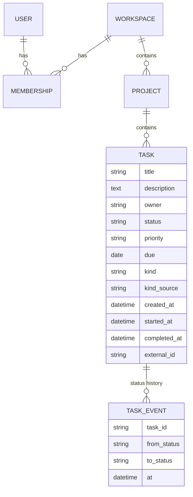

# Architecture (Phase 1)

## Layout

```
backend/
  app/
    main.py            app setup, CORS, routers
    config.py          settings from environment variables
    db.py              engine and sessions; normalises hosted Postgres URLs
    models.py          users, workspaces, memberships, projects, tasks, task_events
    schemas.py         Pydantic request/response models
    security.py        bcrypt hashing, JWT
    deps.py            current user and tenant-scoped lookups
    timeutil.py        UTC handling shared by SQLite and Postgres
    routers/           auth, projects (+ health), tasks, data (import, demo)
    services/
      importer.py      CSV parsing, column mapping, normalisation, quality report
      demo_data.py     deterministic six-month ticket history generator
      insights.py      rule-based health checks
  alembic/versions/    0001 initial schema, 0002 ticket history
  tests/
web/
  src/app/
    core/              API client, auth service, interceptor, guards, models, workspace store
    shared/            modal, formatting helpers
    features/
      auth/            sign-in and registration
      shell/           sidebar, welcome, import and new-project dialogs
      project/         project page, board, ticket dialog, project context
  docker/              nginx config and runtime config script
```

## Data model



`kind_source` is `label` when the ticket type came from an import or a person, and empty when it's unknown. Phase 2's text classifier predicts types for unknown tickets and trains on the labelled ones.

## Status history

`routers/tasks.py:apply_status` is the single place a status changes. It records a `TaskEvent`, sets `started_at` the first time work starts, sets `completed_at` on done, and clears it if a ticket is reopened. Imports and the demo generator create the same events, so every ticket has a consistent history whatever its source.

## CSV import

1. Read with pandas (UTF-8, falling back to Latin-1), with limits of 5 MB and 5,000 rows.
2. Map columns by normalised aliases (for example Summary, Title or Name become the title).
3. Normalise values: statuses ("In Review" becomes in progress), types ("Story" becomes feature), priorities ("Blocker" becomes high), and dates in mixed formats.
4. Skip rows without a title, duplicate keys, or completion dates before creation, and count each reason.
5. Infer missing start dates and warn about missing columns that weaken analytics.
6. Save the project, tickets and status events in one transaction.

## Tenant isolation

Project and ticket lookups go through `deps.get_project_for_user` and `deps.get_task_for_user`, which join on the current user's membership. `tests/test_isolation.py` checks every endpoint returns 404 for another user's data.
